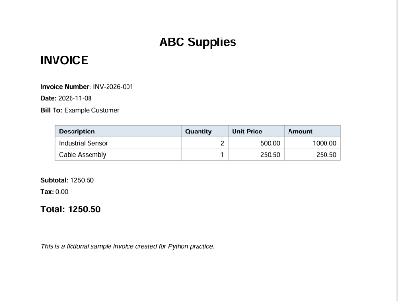
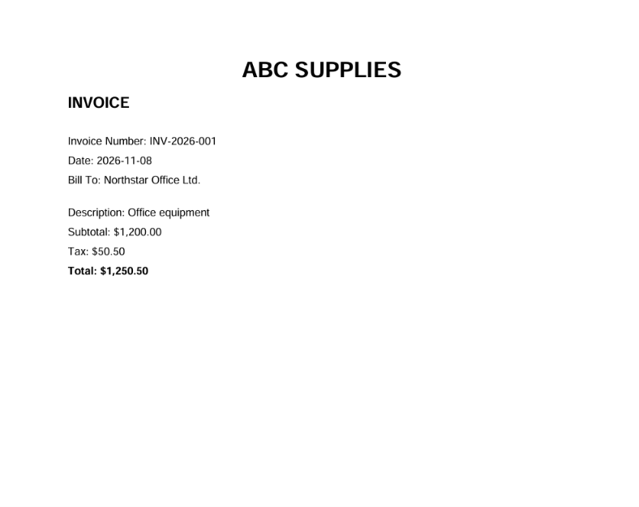
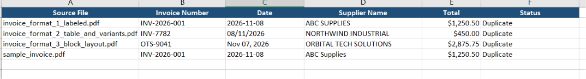
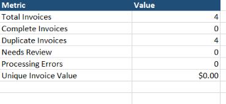

# Invoice Processing Automation

A Python project that automates the basic process of reading invoice PDFs, extracting important information, checking for missing fields and duplicate invoices, and generating reports.

I built this project to reduce repetitive manual work involved in processing invoices and organizing invoice records.




## What does it do?

The program scans PDF invoices from an input folder and extracts the following information:

- Invoice Number
- Invoice Date
- Supplier Name
- Total Amount

After extracting the information, it checks whether required fields are missing and identifies duplicate invoices using a SQLite database.

The results are saved in CSV and Excel reports.



## Features

- **PDF Processing:** Reads multiple PDF invoices in one run.
- **Data Extraction:** Extracts invoice details from different sample invoice layouts using Python and regular expressions.
- **Data Validation:** Identifies invoices with missing information and marks them for review.
- **Duplicate Detection:** Uses SQLite to identify duplicate invoices, including invoices processed in previous runs.
- **CSV Export:** Saves extracted invoice records in CSV format.
- **Excel Reporting:** Generates an Excel report containing invoice records and a summary of processing results.

## Technologies Used

- Python
- pdfplumber
- SQLite
- OpenPyXL
- CSV
- Regular Expressions

## Project Structure

```text
invoice-automation/
│
├── invoices/             # Input PDF invoices
│
├── output/               # Generated CSV and Excel reports
│
├── data/                 # SQLite database
│
├── src/
│   ├── main.py           # Main application
│   ├── extractor.py      # Invoice data extraction
│   └── database.py       # Database and duplicate detection
│
├── requirements.txt
├── README.md
└── .gitignore
```

## Installation

**1. Clone the repository**

```bash
git clone https://github.com/YOUR-USERNAME/invoice-automation.git
```

**2. Open the project directory**

```bash
cd invoice-automation
```

**3. Create a virtual environment**

```bash
python -m venv .venv
```

**4. Activate the virtual environment**

Windows:

```bash
.venv\Scripts\activate
```

**5. Install the required packages**

```bash
pip install -r requirements.txt
```

## How to Run

Place your PDF invoices inside the `invoices` folder.

Run the application from the project root directory:

```bash
python src/main.py
```

After processing, the generated reports will be available in the `output` folder.

- `invoice_results.csv`
- `invoice_report.xlsx`

The SQLite database is stored in the `data` folder and maintains invoice records between application runs.

## Current Limitations

This project currently uses rule-based extraction with regular expressions. It works with the invoice layouts used during development, but it is not designed to recognize every possible invoice format.

Invoices with unfamiliar layouts or missing information may require manual review.

OCR for scanned invoices and more advanced invoice recognition are not currently implemented.

## Future Improvements

Some improvements I may explore in future versions:

- OCR support for scanned PDF invoices.
- Support for more invoice layouts.
- Improved validation of dates and amounts.
- More detailed processing logs.
- A graphical user interface.

## Project Status

Completed initial version. The core processing, validation, duplicate detection, and reporting features have been implemented and tested with sample PDF invoices.


